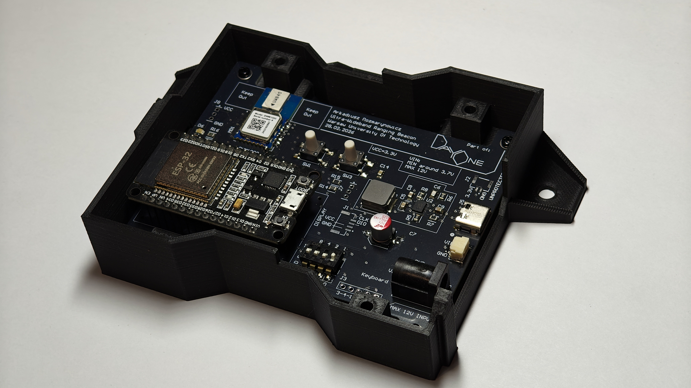
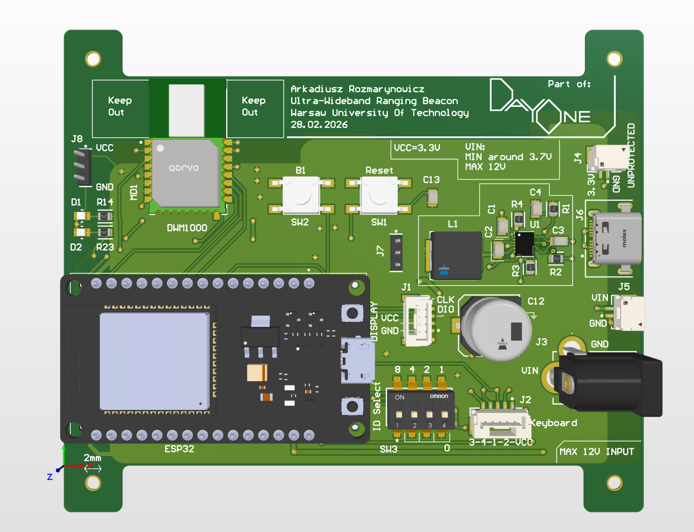
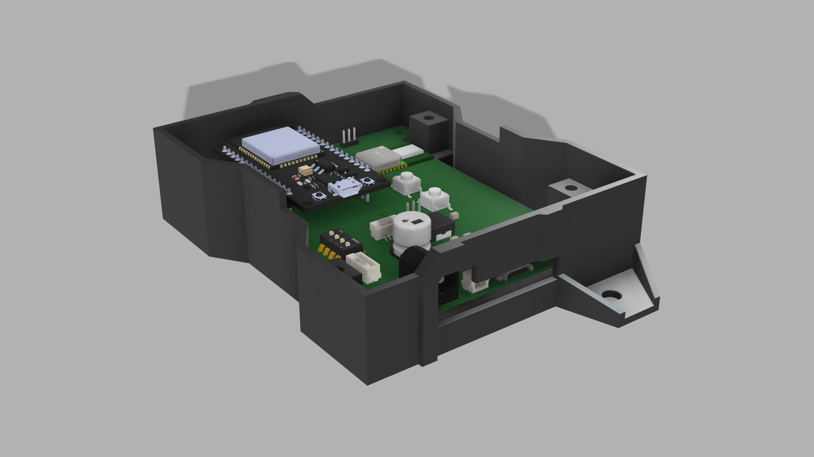
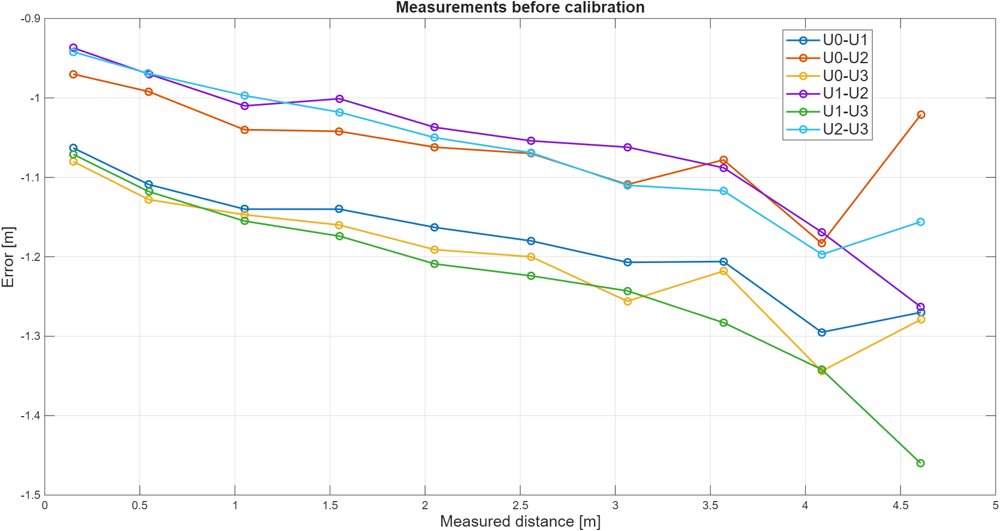
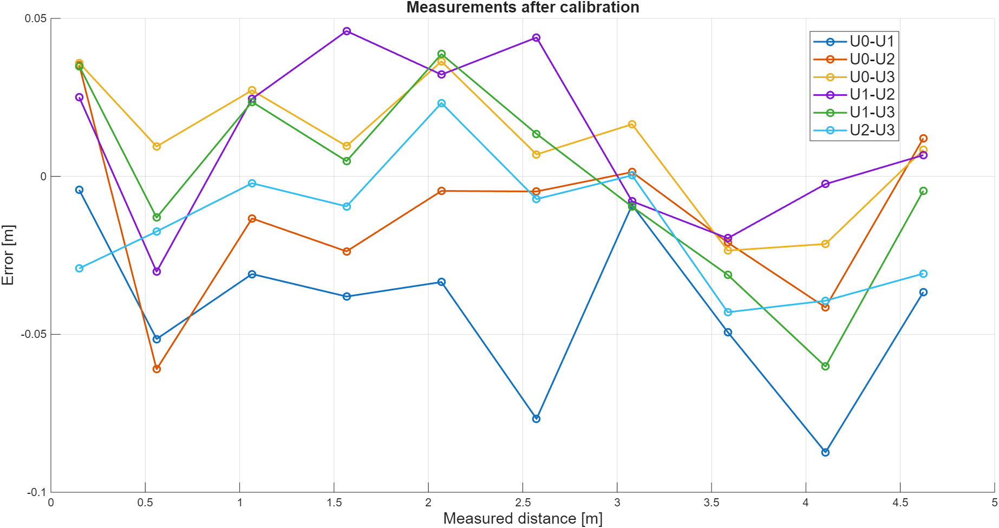
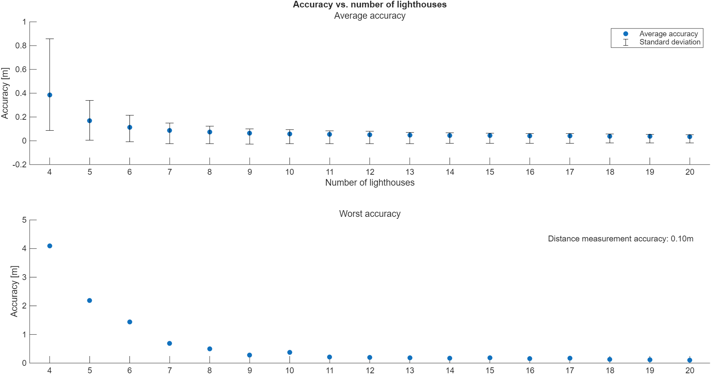
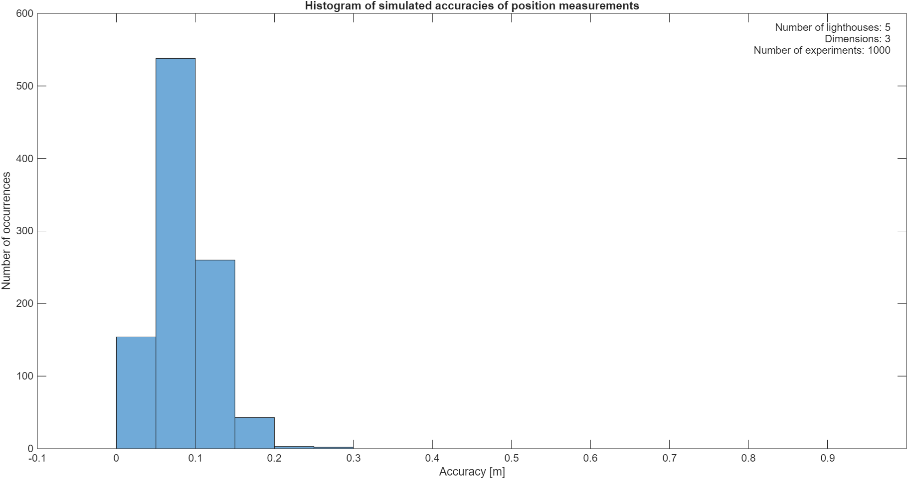
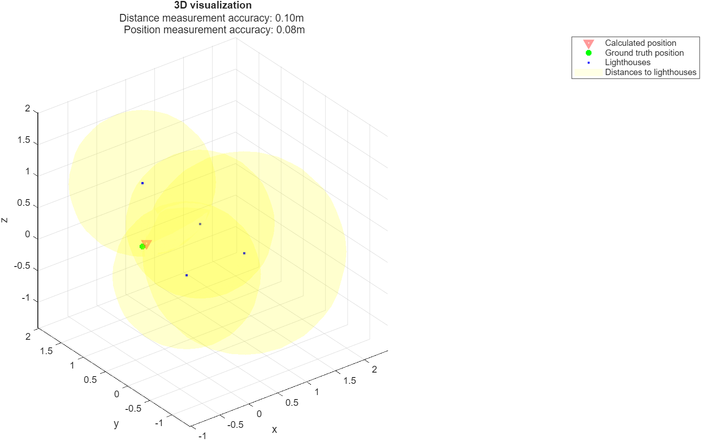
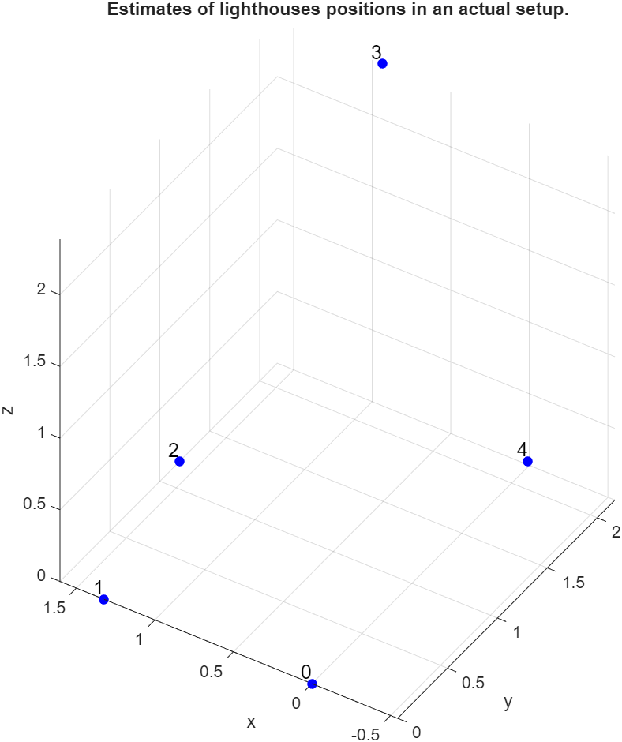

# UWB Positioning System
An indoor positioning system based on the Ultra-Wideband technology. It allows centimeter-accurate positioning of a moving tag, without relying on a GPS signal.

Implemented software, hardware, simulation, and error calibration.

Development time: from 10.2025 to 02.2026.


## Table of contents
* [General information](#general-information)
* [Calibration](#calibration)
* [Simulation](#simulation)
* [Effectiveness](#effectiveness)
* [Technologies](#technologies)
* [Project structure](#project-structure)
* [Setup](#setup)
* [Note on collaborators](#note-on-collaborators)
* [Naming convention](#naming-convention)
* [Roadmap](#roadmap)
* [Future](#future)

## General information
- A communication system consisting of a moving tag and at least four ranging anchors.
- The tag and anchors are based on a DWM1000 ranging module and an ESP32.
- The anchors automatically determine their relative position on start-up.
- Implemented the least square error method for estimating the 3D coordinates, based on uncertain distance measurements.
- Connected the system to a ground station that fine-tunes modules' positions using Gauss-Newton iterative algorithm.
- Performed experiments and collected data that allowed error compensation at distances up to 4.5m.
- Designed and built a custom PCB with a 3D printed casing.
- Simulated and visualized the process in MATLAB.

----

<p align="center">
<br>
<em>UWB anchor.</em>
</p>

<p align="center">
<br>
<em>3D view of the PCB.</em>
</p>

<p align="center">
<br>
<em>3D model.</em>
</p>

## Calibration

Calibration was necessary to compensate for antenna delays that varied between individual lighthouse modules and affected the measured distances. To characterize these errors, I measured the distance estimation errors between all pairs of lighthouses over a range of distances up to 4.5m.

I then used the least-squares method to estimate the time offset associated with each module. Assuming that the distance error between modules $i$ and $j$, denoted by $\epsilon^{ij}$, results from their respective timing errors, $\Delta t_{AD}^i$ and $\Delta t_{AD}^j$, we can express their relationship as:

```math
\begin{equation}
\Delta t_{AD}^i + \Delta t_{AD}^j
= -\frac{\epsilon^{ij}}{c}
\end{equation}
```

where $c$ is the speed of light and $\Delta t_{AD}^i$ represents the antenna delay correction for module $i$.

With four lighthouse modules, there are

```math
\begin{equation}
\frac{4(4-1)}{2}=6
\end{equation}
```

unique module pairs, resulting in six independent measurements. These measurements allow us to formulate the following overdetermined system of linear equations:

```math
\begin{equation}
\underbrace{
\begin{bmatrix}
1 & 1 & 0 & 0\\
1 & 0 & 1 & 0\\
1 & 0 & 0 & 1\\
0 & 1 & 1 & 0\\
0 & 1 & 0 & 1\\
0 & 0 & 1 & 1
\end{bmatrix}}_{\mathbf{A}}
\underbrace{
\begin{bmatrix}
\Delta t_{AD}^0\\
\Delta t_{AD}^1\\
\Delta t_{AD}^2\\
\Delta t_{AD}^3
\end{bmatrix}}_{\mathbf{x}}
=
\underbrace{
\begin{bmatrix}
-\epsilon^{01}/c\\
-\epsilon^{02}/c\\
-\epsilon^{03}/c\\
-\epsilon^{12}/c\\
-\epsilon^{13}/c\\
-\epsilon^{23}/c
\end{bmatrix}}_{\mathbf{b}}
\end{equation}
```

The system can be solved in the least-squares sense by finding

```math
\begin{equation}
\mathbf{x}_{LS}
=
\underset{\mathbf{x}}{\argmin}
\|\mathbf{A}\mathbf{x}-\mathbf{b}\|_2^2
\end{equation}
```

This provides an estimate of the antenna delay correction for each lighthouse module, which can then be incorporated into the measurement code.

Once the timing offsets had been determined, I applied the corresponding corrections to the measurements in MATLAB. I then performed a simple linear fit to compensate for the remaining distance-dependent measurement errors.

The measurements before calibration are shown below:

<p align="center">
<br>
<em>Experiments from before calibration.</em>
</p>

As can be seen, all measurements exhibit a similar linear trend, with errors of approximately one meter. This indicates a significant systematic error shared across the lighthouse modules.

After applying the calibration procedure, the measurement errors decreased substantially, reaching approximately 5cm:

<p align="center">
<br>
<em>Experiments from after calibration.</em>
</p>

The results demonstrate a significant improvement in measurement accuracy, reducing the errors from approximately one meter to just a few centimeters.

## Simulation

Simulation is a useful tool for determining the optimal number and placement of lighthouse modules. It also makes it possible to analyse how positioning accuracy is affected by individual distance measurement errors and the spatial configuration of the modules.

First, I simulated how the average positioning accuracy changes with the number of available lighthouses. The results show that adding more lighthouses generally improves positioning accuracy:

<p align="center">
<br>
<em>Average positioning accuracy as a function of the number of lighthouse modules.</em>
</p>

Based on these results, I selected five lighthouses as an optimal configuration for further analysis. Assuming a distance measurement accuracy of 10 cm for each lighthouse, I simulated the resulting positioning accuracy across the measurement area:

<p align="center">
<br>
<em>Positioning accuracy distribution for five lighthouse modules, assuming a distance measurement accuracy of 10 cm.</em>
</p>

The simulation framework also provides an option to visualize the results in three dimensions, making it easier to interpret the spatial distribution of positioning errors:

<p align="center">
<br>
<em>Three-dimensional visualization of a simulation result.</em>
</p>

The framework allows different lighthouse configurations to be evaluated by changing the positions of individual modules. This makes it possible to investigate how their spatial arrangement affects positioning accuracy and identify configurations that provide better coverage and more reliable position estimates.

Finally, the ground station can display calculated lighthouses relative positions:

<p align="center">
<br>
<em>Modules' positions estimations, displayed from ground station.</em>
</p>

## Effectiveness
The system allows for positioning of a tag with an accuracy of around 20cm at around 4Hz update rate.

## Technologies
Programming languages:
- C
- C++
- MATLAB

Communication protocols:
- UWB
- ESP-NOW
- SPI
- UART
- I2C

Tools used:
- PlatformIO
- STM32 Cube IDE
- Altium Designer
- Autodesk Fusion

## Project structure
The project has been split into three parts: software, hardware, and simulation.

- [Software](/Software/) consists of code for the tag and anchors.
- [Hardware](/Hardware/) consists of a PCB project and 3D-printed casing files.
- [Simulation](/Simulations/) consists of MATLAB code that allows for testing and visualizing different setups.


## Setup
To run the project, please first refer to the details in the [Hardware](/Hardware/) folder, and then follow the instructions in the [Software](/Software/) folder.

## Note on collaborators
The majority of commits come from "RocketEquation" and "arozmary" accounts, both of which belong to me.

## Naming convention
- The anchors are also referred to as "lighthouses".
- The tag is also referred to as an "observer".
- The module that reads data from the tag is also referred to as a "sailor".

## Roadmap
- [x] Distance measurements among the anchors
- [x] Automatic 3D estimation of each anchor relative to the others
- [x] 3D position estimation of the tag
    - [x] Least squares method
    - [ ] Weighted least squares method
- [x] PCB and 3D-printed casing
- [x] Test of the setup on a slowly moving tag
- [x] Integration with a ground station
- [x] Integration with an UAV

## Future
The project will play an important role in the development of my Bachelor's project: "Design and implementation of a quadrotor with a localization algorithm based on Ultra-Wideband beacons", which you can follow through this [repository](https://github.com/A-Rozmarynowicz/Portfolio_Quadcopter).
